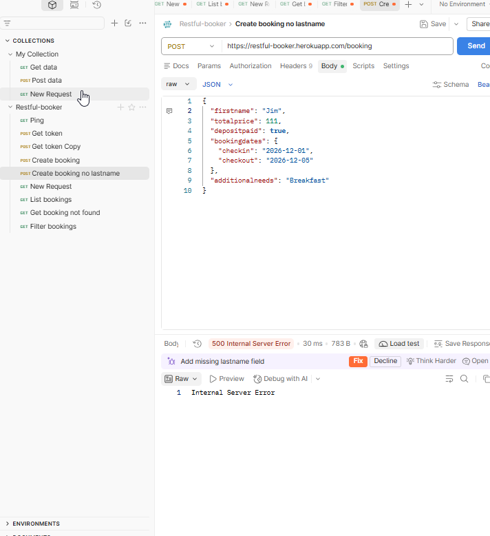

# BUG-001: Server returns 500 when a booking is created without the required lastname

| Field | Value |
|---|---|
| ID | BUG-001 |
| Status | New |
| Severity | Medium |
| Priority | Medium |
| Area | API |
| Related test case | TC-008 |
| Environment | Restful-booker public instance (https://restful-booker.herokuapp.com), Postman |
| Reported on | 2026-11-18 |

## Description
`POST /booking` with the required `lastname` field missing makes the server fail with `500 Internal Server Error` instead of rejecting the invalid input with a 4xx validation error.

## Steps to reproduce
1. Send `POST https://restful-booker.herokuapp.com/booking` with the headers `Content-Type: application/json` and `Accept: application/json`.
2. Use this body (the `lastname` field is left out):
```json
{
  "firstname": "Jim",
  "totalprice": 111,
  "depositpaid": true,
  "bookingdates": {
    "checkin": "2026-12-01",
    "checkout": "2026-12-05"
  },
  "additionalneeds": "Breakfast"
}
```
3. Check the response.

## Expected result
The request is rejected with a 4xx client error (for example 400 Bad Request) and no booking is created.

## Actual result
Status `500 Internal Server Error`, response body `Internal Server Error`. No `bookingid` is returned.

## Evidence

