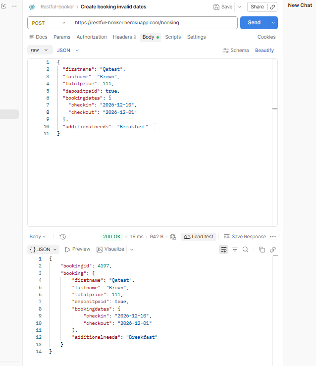

# BUG-002: Booking is accepted with a checkout date before the checkin date

| Field | Value |
|---|---|
| ID | BUG-002 |
| Status | New |
| Severity | Medium |
| Priority | Medium |
| Area | API |
| Related test case | TC-009 |
| Environment | Restful-booker public instance (https://restful-booker.herokuapp.com), Postman |
| Reported on | 2026-11-18 |

## Description
`POST /booking` accepts and stores a booking whose `checkout` date is earlier than its `checkin` date. No validation error is returned.

## Steps to reproduce
1. Send `POST https://restful-booker.herokuapp.com/booking` with the headers `Content-Type: application/json` and `Accept: application/json`.
2. Use this body (checkout is before checkin):
```json
{
  "firstname": "Qatest",
  "lastname": "Brown",
  "totalprice": 111,
  "depositpaid": true,
  "bookingdates": {
    "checkin": "2026-12-10",
    "checkout": "2026-12-01"
  },
  "additionalneeds": "Breakfast"
}
```
3. Check the response.

## Expected result
The request is rejected with a 4xx validation error, or the invalid dates are flagged, and no booking is created.

## Actual result
Status `200 OK`. The booking is created (`bookingid` 4197) and the response contains the invalid dates unchanged (`checkin` 2026-12-10, `checkout` 2026-12-01).

## Evidence


